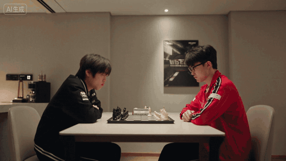
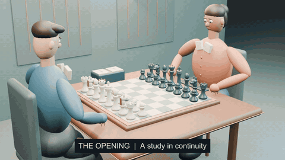
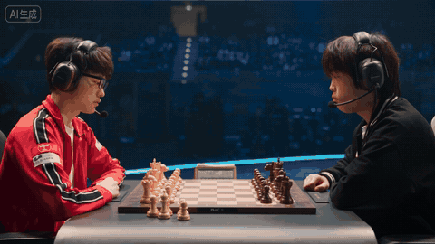
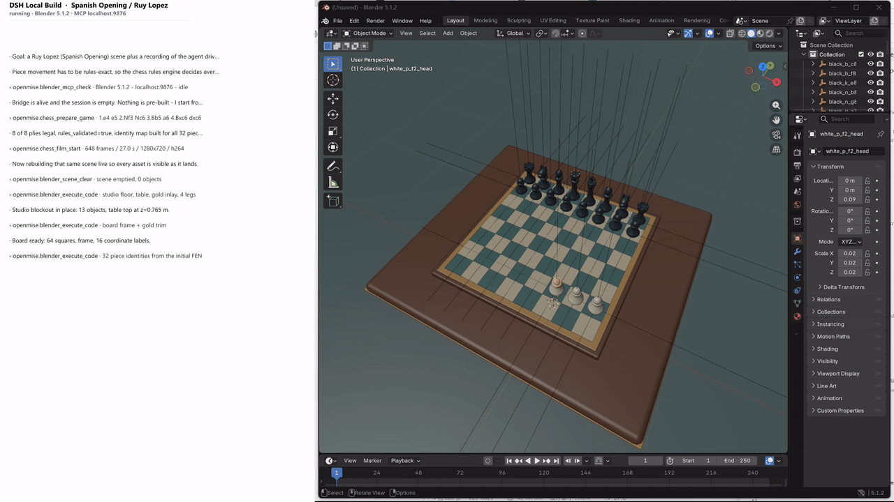
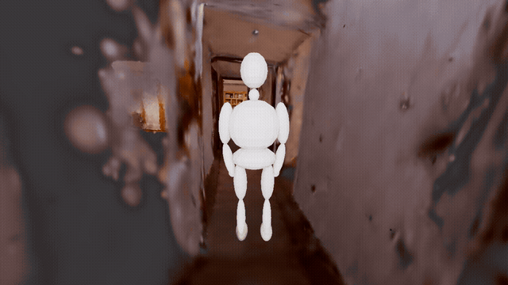

# OpenMise

[简体中文](README.md) | **English**

**The bridge connecting Agents to spatial scenes.**

OpenMise is a set of spatial scene editing tools for Agents. It connects an Agent's understanding
of a task to concrete operations in a spatial scene: observing environments, managing assets,
editing spatial relationships, arranging characters and motion, designing cameras and lighting,
and checking the results through rendered previews.

Its role in the ecosystem is **the bridge connecting Agents to spatial scenes**. The Agent interprets
the request and organizes the work; OpenMise supplies spatial editing workflows and operation
conventions; scene tools such as Blender execute the operations. Video is one way to present
the result, alongside editable 3D projects and scene previews.

This open-source edition provides those workflows as **Agent Skills, reference documents, and
optional model helpers bundled with the skills**, together with showcase videos. It does not
include a standalone application, Blender execution backend, plugin service, or model weights.
Your Agent reads the skills and operates the scene through your existing Blender tools.

```text
User request → Agent → OpenMise spatial editing workflows → Blender operations
                            ↑                                   ↓
                            └──── Preview, inspect, iterate ────┘
```

## Videos and examples

These demonstrations were recorded with a configured toolchain and illustrate spatial editing
and downstream applications. Reproduction requires the relevant host, execution tools, and assets;
downloading this repository does not install the complete demonstrated toolchain.
Start with the three-way chess comparison, then explore scene editing and scanned-scene navigation.
GIFs play inline; the scene editing and room-walk demonstrations also include full MP4 videos.

### Results compared: prompt-only generation → OpenMise blockout → rendering from the blockout

The chess examples compare two production paths: **generate a video directly from a text prompt**,
or **use OpenMise to build a spatial scene and generate a blockout video, then render the final
video using that blockout as a reference**. The three previews show the direct generation result,
the spatial and motion reference created with OpenMise, and the result rendered using that reference.

| ① Chess video generated from a prompt alone | ② Blockout video generated with OpenMise | ③ Final video rendered using the blockout |
|:---:|:---:|:---:|
|  |  |  |
| **Text prompt → Video** | **Agent + OpenMise → Editable scene → Blockout video** | **Blockout video + Rendering → Final video** |
| Describe the players, board, and actions in text and send the prompt directly to a video model. | Organize the board, pieces, players, move sequence, and cameras in a 3D scene, then export an inspectable blockout video. | Use the blockout video as a spatial and motion reference while rendering the visual style and appearance. |

**OpenMise turns the spatial relationships and action requirements in a prompt into an editable,
previewable scene, giving downstream rendering an explicit spatial and motion reference.**
When comparing the previews, look at piece positions and identity, move order, the players'
positions relative to the board, and how these structures and actions carry into the rendered result.

The blockout is produced through the OpenMise workflow. The third example shows downstream
rendering based on that blockout; the rendering service is outside this open-source edition.

### Scene editing: building a chess scene

[](assets/readme/spanish-opening-scene-editing.mp4)

The recording shows the board, pieces, characters, and lighting being assembled in Blender.
The public recording retains the Blender editing area; the session log panel and window title bar
have been cropped out. The GIF covers seconds 28–44.
[Watch the full scene editing video, approximately 98 seconds](assets/readme/spanish-opening-scene-editing.mp4).

### Scanned scenes: a character walking through a 3DGS room

[](assets/readme/walk-in-3dgs-room.mp4)

A scanned environment, a procedural character, and a moving camera in one scene.
[Watch the full 16-second video](assets/readme/walk-in-3dgs-room.mp4).

## What you can do

| Task | What the skills guide the Agent to do |
|---|---|
| Blockout animation and shot previs | Plan objects, spatial relationships, and timing; inspect keyframes before exporting a project and video |
| 3DGS scene understanding | Capture useful views and check orientation, scale, local supports, and semantic locations |
| Characters and motion | Import or create simple actors, inspect rigs, place assets, import motion, or animate basic actions |
| Character navigation | Plan routes within evidenced planar walkable areas and check doors, corners, and clearance |
| Cameras and lighting | Frame shots, set depth of field, follow or orbit subjects, dolly, zoom, and light scenes |
| Delivery and verification | Save `.blend` projects, render images or sequences, encode video, and inspect the actual output |

## Getting started

### 1. Prepare your environment

- An AI Agent host that can read `SKILL.md` files and invoke local tools.
- A working Blender installation and an interface your host can use to operate it, such as
  [Blender MCP](https://github.com/ahujasid/blender-mcp). Follow the upstream setup instructions.
- For visual acceptance, an image reader in the host or an actual configured vision service.
- FFmpeg for video encoding. 3DGS tasks also require a compatible splat importer and renderer,
  such as [KIRI 3DGS Render](https://github.com/Kiri-Innovation/3dgs-render-blender-addon).

Reading the skills requires no Python packages. Additional dependencies are needed only for the
optional model helpers; see their [dependency and input guide](skill/blender-3dgs/references/tools.md).
Provide your own character models, textures, scans, and motion files.

### 2. Load the skills

Download the repository and give your Agent its local path and the [skill entrypoint](skill/SKILL.md).
For example:

> Read skill/SKILL.md in this repository, then load the topic guides needed for my request.
> Check which Blender tools you can actually use, preserve the current project, and inspect
> rendered previews before exporting the video.

If your host supports directory-based skill installation, copy the entire `skill/` directory into
its skills directory, rename that copy to `openmise`, and keep all subdirectories:

```text
<host skills directory>/
└── openmise/
    ├── SKILL.md
    ├── references/
    ├── openmise-builder/
    │   └── SKILL.md
    └── …
```

The entrypoint routes requests to topic guides. You do not need to install every nested topic
globally. Skill discovery varies by host; use the directory and configuration your host supports.
There is no npm installation or plugin registration command to run in this repository.

### 3. Start with a small task

> Create a five-second blockout animation at 24 fps: a simple character takes two steps forward,
> then turns around. Use a fixed wide shot. Inspect body proportions, foot contact, and the turn
> in previews, then export an MP4 and an editable Blender project after the checks pass.

Or work with your own assets:

> Import my character and motion files. Check the rig and missing textures. Preserve the existing
> scene, show a full-body preview first, and explain motion compatibility and any corrections needed.

> Load my 3DGS scan. Establish up direction, floor support, and scale evidence before deciding
> whether a character can walk from the doorway to the table. Keep unsupported locations unknown.

Give the Agent your output directory, asset paths, and any required measurements.
The Agent must use actual tools for inspection; skill names are not registered tool calls.

## Skill navigation

The complete topic table is in [skill/SKILL.md](skill/SKILL.md). Common starting points:

- [Blockout scenes](skill/openmise-builder/SKILL.md) and [generated scenes](skill/openmise-generated-scene/SKILL.md)
- [Scan observation and calibration](skill/openmise-scene-understanding/SKILL.md) and [3DGS orientation and recognition](skill/blender-3dgs/SKILL.md)
- [Character workflows](skill/openmise-character-layout/SKILL.md), [navigation](skill/openmise-character-navigation/SKILL.md), and [motion import](skill/openmise-motion-import/SKILL.md)
- [Cinematography](skill/openmise-cinematography/SKILL.md), [camera motion](skill/openmise-camera-motion/SKILL.md), and [lighting](skill/openmise-lighting/SKILL.md)
- [Project and video output](skill/openmise-output/SKILL.md)

## What completion means

Successful tool execution, passing geometry checks, acceptable actual images, and playable output
files are separate results. The workflow establishes evidence, creates previews, inspects the actual
images, fixes problems, and then renders and checks the final output. Changes to the scene,
animation, or camera require fresh checks of affected previews.

Deliverables usually include a `.blend` project, preview images, an image sequence or MP4, and a
record of checked items and remaining limitations. Without image-reading capability, the Agent
should explicitly mark visual acceptance as pending.

## Scope and limitations

- Skills guide the workflow. Results depend on the host model, tools, assets, and Blender environment;
  arbitrary scenes are not guaranteed to complete automatically.
- 3DGS is not a complete collision mesh. Correct up direction does not establish scale, supports,
  doorways, or reachability.
- Navigation guidance primarily covers verified single-floor planar areas. Stairs, multiple levels,
  dynamic avoidance, and full-body collisions need additional capabilities.
- Procedural characters suit previs. Complex dances require real motion and compatible rigs;
  cloth and hair physics need separate handling.
- Optional model helpers do not connect to Blender or apply transforms. The vision service helper
  sends images to the endpoint configured by the user.
- This edition supports Blender scene workflows and local rendering; it provides no cloud video
  generation service.

## Contributing

Contributions can improve general workflows, fix reproducible problems, and make the skills and
examples easier to use. Include host, Blender, and addon versions, minimal reproduction steps,
and any necessary redacted screenshots when reporting an issue.

Submit only publicly distributable skills, documents, and sanitized showcase resources. Keep
credentials, personal paths, real user assets, and execution logs out of contributions.
Store work records and routine generated media outside the repository. Showcase media are
tracked through an explicit filename allowlist.

## License

Repository content is released under the [MIT License](LICENSE).
Blender, addons, model weights, characters, and motion assets retain their own licenses;
this repository's license does not grant redistribution rights to those external resources.
