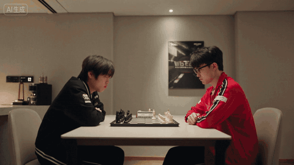
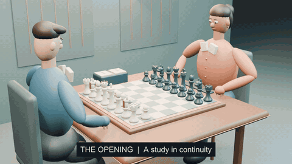
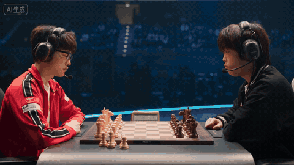
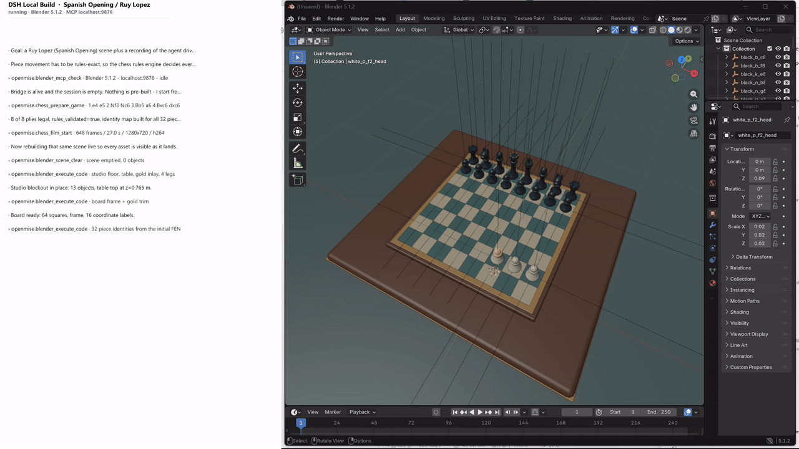
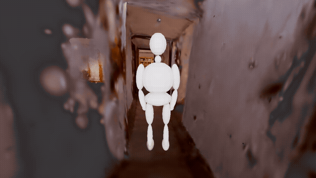

# OpenMise

**简体中文** | [English](README.en.md)

**Agent 链接空间场景的桥梁。**

OpenMise 本质是一套提供给 Agent 的空间场景编辑工具。它连接 Agent 的任务理解与空间场景中的
实际操作，让 Agent 能够观察环境、管理资产、编辑空间关系、安排人物与动作、设计镜头与灯光，
并通过渲染预览检查结果。

在生态中，OpenMise 的定位是 **“Agent 链接空间场景的桥梁”**：Agent 负责理解需求与组织任务，
OpenMise 提供空间编辑的工作流程和操作约定，Blender 等场景工具承担实际执行。
视频是空间编辑结果的一种表达，也可以交付可继续编辑的三维工程和场景预览。

当前开源版本以 **Agent Skills、参考文档及技能自带的可选模型辅助脚本** 提供这些工作流程，
并附展示视频。仓库不包含独立应用、Blender 执行后端、插件服务或模型权重。
使用时，Agent 读取技能并通过你已有的 Blender 工具操作场景。

```text
用户需求 → Agent → OpenMise 空间编辑工作流 → Blender 场景操作
                    ↑                          ↓
                    └──── 预览检查与迭代 ────────┘
```

## 视频与案例

以下展示来自已配置完整工具链的演示，说明空间编辑及其下游应用效果。
复现需要相应宿主、执行工具和素材；下载本仓库不会自动安装演示中的完整工具链。
先看下棋视频的三组效果对比，再看场景编辑与扫描导航演示。动图可直接预览；
场景编辑和房间行走演示还提供完整 MP4。

### 效果对比：仅用提示词生成 → OpenMise 白模 → 基于白模渲染

围绕下棋场景，对照两条制作路径：**仅用提示词直接生成视频**，以及
**先用 OpenMise 构建空间场景、生成白模视频，再以白模为参考渲染成片**。
下面三段动图依次展示直接生成的结果、OpenMise 提供的空间与动作参考，以及使用该参考后的渲染结果。

| ① 仅用提示词生成的下棋视频 | ② OpenMise 生成的白模视频 | ③ 使用白模视频后渲染的成片 |
|:---:|:---:|:---:|
|  |  |  |
| **提示词 → 视频** | **Agent + OpenMise → 可编辑场景 → 白模视频** | **白模视频 + 渲染 → 成片** |
| 用文字描述人物、棋盘与下棋动作，直接交给视频模型生成。 | 在三维场景中组织棋盘、棋子、人物、棋步和镜头，输出可检查的白模视频。 | 将白模视频作为空间布局与动作参考，再完成画面风格与外观渲染。 |

**OpenMise 的作用，是把提示词中的空间关系与动作要求落实到可编辑、可预览的场景，
让后续渲染有明确的空间与运动参考。** 对照观看时，可以重点观察棋子位置与身份、
棋步先后、人物与棋盘的相对关系，以及渲染成片对这些结构和动作的保留。

白模由 OpenMise 工作流生成；第三段展示在白模基础上的下游渲染效果，该渲染服务不包含在当前开源版本中。

### 场景编辑：国际象棋空间搭建

[](assets/readme/spanish-opening-scene-editing.mp4)

从棋盘、棋子到人物、灯光，展示空间资产逐步进入 Blender 场景的过程。
公开录屏保留 Blender 编辑区域，已裁去会话日志面板与窗口标题栏。
动图为第 28–44 秒节选；[观看完整场景编辑视频，约 98 秒](assets/readme/spanish-opening-scene-editing.mp4)。

### 扫描场景：人物在 3DGS 房间中行走

[](assets/readme/walk-in-3dgs-room.mp4)

展示扫描环境、程序化人物与运动镜头的组合；
[观看完整视频，16 秒](assets/readme/walk-in-3dgs-room.mp4)。

## 可以做什么

| 需求 | 技能会指导 Agent 做什么 |
|---|---|
| 白模动画与镜头预演 | 拆解对象、空间关系与时间轴，先做关键帧预览，再输出工程和视频 |
| 3DGS 扫描理解 | 获取有效视图，检查方向、尺度、局部支撑与语义位置 |
| 人物与动作 | 导入或创建简单人物、检查骨架、摆放、导入动作或生成基础动作 |
| 人物导航 | 在已确认的平面可走区域规划路线，检查门洞、转角与净空 |
| 摄影与灯光 | 静态构图、景深、跟拍、环绕、推拉、变焦和布光 |
| 交付与检查 | 保存 `.blend`，渲染图片/序列，编码视频并检查实际结果 |

## 开始使用

### 1. 准备环境

- 一个支持读取 `SKILL.md`、调用本地工具的 AI Agent 宿主。
- 可正常运行的 Blender，以及该宿主可用的 Blender 操作接口；例如
  [Blender MCP](https://github.com/ahujasid/blender-mcp)。按上游说明完成连接。
- 如需视觉验收，宿主应能读取渲染图片，或配置真实可用的视觉服务。
- 视频编码需要 FFmpeg；3DGS 任务另需兼容的高斯导入/渲染附加组件，例如
  [KIRI 3DGS Render](https://github.com/Kiri-Innovation/3dgs-render-blender-addon)。

只阅读技能不需要安装 Python 包。只有使用可选模型脚本时才需要其额外依赖，
见[脚本说明](skill/blender-3dgs/references/tools.md)。人物、纹理、扫描与动作文件由使用者自行提供。

### 2. 加载技能

下载仓库后，向 Agent 提供[技能入口](skill/SKILL.md)及本地仓库路径，例如：

> 请先阅读这个仓库的 skill/SKILL.md，再按任务加载对应主题。先检查你实际可用的 Blender 工具，
> 保留当前工程，预览检查后再输出视频。

如果宿主支持目录式技能安装，将整个 `skill/` 目录复制到它的技能目录，
并将这份目录命名为 `openmise`，保留全部子目录：

```text
<宿主技能目录>/
└── openmise/
    ├── SKILL.md
    ├── references/
    ├── openmise-builder/
    │   └── SKILL.md
    └── …
```

入口会按任务加载主题。无需把各子主题逐个安装到全局技能目录；
不同宿主的技能发现方式不同，请使用其实际支持的目录与配置。
本仓库没有需要运行的 npm 安装或插件注册命令。

### 3. 从小任务开始

> 新建一个 5 秒白模动画：一个简单人物向前走两步，再转身。固定全景，24 fps。
> 先检查人物比例、脚底接触和转身预览，通过后输出 MP4 与可编辑 Blender 工程。

也可以编辑自己的素材：

> 导入我提供的人物和动作文件，检查骨架与缺失纹理。保留原场景，先给我一张全身预览，
> 再说明动作兼容性与需要修正的地方。

> 加载我提供的 3DGS 扫描，先确认向上方向、地面与尺度依据，再判断人物能否从门口走到桌旁。
> 没有证据的位置请保留未知。

将输出目录、素材路径和必要尺寸告诉 Agent 即可。Agent 应使用实际工具完成检查，
不能把本仓库的技能名称当作已经注册的工具调用。

## 技能导航

完整主题表见[skill/SKILL.md](skill/SKILL.md)。常用入口：

- [基础白模](skill/openmise-builder/SKILL.md)与[复杂场景生成](skill/openmise-generated-scene/SKILL.md)
- [扫描观察与校准](skill/openmise-scene-understanding/SKILL.md)与[3DGS 方向/识别](skill/blender-3dgs/SKILL.md)
- [人物工作流](skill/openmise-character-layout/SKILL.md)、[人物导航](skill/openmise-character-navigation/SKILL.md)与[动作导入](skill/openmise-motion-import/SKILL.md)
- [摄影](skill/openmise-cinematography/SKILL.md)、[运动镜头](skill/openmise-camera-motion/SKILL.md)与[布光](skill/openmise-lighting/SKILL.md)
- [工程与视频输出](skill/openmise-output/SKILL.md)

## 如何判断任务完成

工具返回成功、几何检查通过、实际画面合格、文件可正常播放，是不同层面的结果。
OpenMise 的工作方式是先确认依据、生成预览、查看实际图片、修正问题，再渲染并检查最终输出。
修改场景、动作或镜头后，应重新检查相关预览。

最终交付通常包括 `.blend`、预览图、图像序列或 MP4，以及已检查项目和剩余限制。
没有图像读取能力时，Agent 应明确标记“待视觉检查”。

## 能力边界

- 技能提供流程指导，实际效果取决于宿主模型、工具、素材与 Blender 环境，不保证任意场景自动完成。
- 3DGS 不是完整碰撞网格；向上方向正确不代表尺度、地面、门洞和可达性已确认。
- 当前导航指导主要面向已验证的单层平面；楼梯、多层、动态避障和全身碰撞需要额外能力。
- 程序化白模适合预演；复杂舞蹈依赖真实动作与骨架兼容，衣服/头发物理需单独处理。
- 可选模型脚本不连接 Blender、不自动应用变换。视觉服务脚本会发送图片到用户配置的服务。
- 本仓库面向 Blender 的场景与本地渲染工作流，不提供云端视频生成服务。

## 参与贡献

欢迎补充通用工作流程、修正可复现的问题、改善技能的可发现性与示例。
提交问题时附上宿主、Blender/附加组件版本、最小复现步骤和必要的脱敏截图。
提交内容仅包含可公开分发的技能、文档与已脱敏展示资源；避免密钥、个人路径、真实用户素材和运行日志。
工作记录与日常生成媒体应保存在仓库外的任务目录；展示媒体按明确文件清单纳入版本管理。

## 许可

本仓库内容按 [MIT License](LICENSE) 发布。
Blender、附加组件、模型权重、人物及动作资产分别遵循其自身许可；
本仓库的许可不授予这些外部资源的再分发权。
